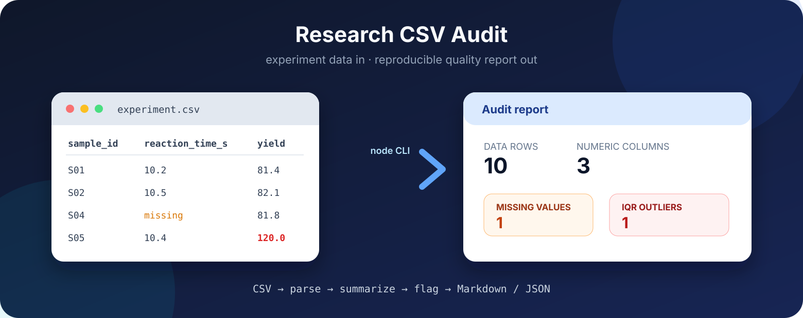

<div align="center">



# research-csv-audit

**Audit research CSV data before analysis: missing values, descriptive statistics, and IQR outliers.**

[](https://github.com/zhchb20110913/research-csv-audit/actions/workflows/ci.yml)
[](package.json)
[](package.json)
[](LICENSE)

[English](README.md) · [简体中文](README.zh-CN.md)

</div>

Research CSV Audit reads an experiment CSV, identifies numeric columns, and
produces a compact quality report. It counts missing values, calculates common
descriptive statistics, and flags potential outliers with the 1.5 × IQR rule.
The CLI has no runtime dependencies and emits Markdown for review or JSON for
downstream automation.

```bash
node bin/research-csv-audit.js samples/experiment.csv
node bin/research-csv-audit.js samples/experiment.csv --output reports/audit.md
node bin/research-csv-audit.js samples/experiment.csv --format json --output reports/audit.json
```

## Features

- **Zero runtime dependencies.** Runs with the Node.js standard library only.
- **Research-oriented summaries.** Reports valid and missing counts, mean,
  median, sample standard deviation, quartiles, range, and IQR outliers.
- **Robust CSV parsing.** Handles quoted commas, escaped quotes, CRLF input,
  UTF-8 BOMs, and missing trailing fields.
- **Two report formats.** Markdown is readable in reviews; JSON is ready for
  scripts, notebooks, and CI pipelines.
- **Reproducible calculations.** The same input and options produce the same
  statistics and ordering.
- **CI-ready.** The test suite covers parsing, calculations, rendering, and CLI
  file output across supported Node.js versions.

## Installation

The project is not published to npm. Clone the repository and run it directly:

```bash
git clone https://github.com/zhchb20110913/research-csv-audit.git
cd research-csv-audit
node --test
```

Requires **Node.js 20+**. No package installation step is needed.

## Quick start

Audit the included experiment data and write both report formats:

```bash
node bin/research-csv-audit.js samples/experiment.csv --output reports/audit.md
node bin/research-csv-audit.js samples/experiment.csv --format json --output reports/audit.json
```

```text
Audit complete: 10 rows, 3 numeric columns.
Report written to .../reports/audit.md
```

The sample data contains one missing reaction-time value and one potential
yield outlier, so it demonstrates both checks in a small file.

## Audit model

| Metric | Definition |
|---|---|
| Valid / missing | Non-missing numeric values and recognized missing markers |
| Mean / median | Arithmetic mean and linearly interpolated 50th percentile |
| Std. dev. | Sample standard deviation using `n - 1` |
| Q1 / Q3 | Linearly interpolated 25th and 75th percentiles |
| IQR outliers | Values outside `Q1 - 1.5 × IQR` and `Q3 + 1.5 × IQR` |

Recognized missing markers are an empty cell, `NA`, `N/A`, `null`, `NaN`, and
`-`, matched case-insensitively. Potential outliers require scientific review;
the tool never deletes or changes observations. See
[docs/metrics.md](docs/metrics.md) for calculation details.

## Example report

| Column | Valid | Missing | Mean | Median | Std. dev. | Min | Q1 | Q3 | Max | IQR outliers |
|---|---:|---:|---:|---:|---:|---:|---:|---:|---:|---:|
| `temperature_c` | 10 | 0 | 29.59 | 29.6 | 7.8537 | 22 | 22.125 | 37 | 37.2 | 0 |
| `reaction_time_s` | 9 | 1 | 8.8889 | 7.9 | 1.3458 | 7.6 | 7.8 | 10.2 | 10.5 | 0 |
| `yield_percent` | 10 | 0 | 90.43 | 91.35 | 11.5377 | 80.9 | 81.875 | 91.75 | 120 | 1 |

## CLI

```text
research-csv-audit INPUT.csv [options]

--delimiter <char>  CSV delimiter, default: comma
--format <type>     markdown or json, default: markdown
--output <path>     write the report to a file
--help              show command help
```

Full behavior and exit codes: [docs/cli.md](docs/cli.md).

## Project layout

```text
research-csv-audit/
├── bin/                    CLI entry point
├── src/                    CSV parser and audit calculations
├── test/                   Node.js test suite
├── samples/                Example experiment data
├── docs/                   Usage and calculation references
└── .github/workflows/      Continuous integration
```

## Development

```bash
node --test
node bin/research-csv-audit.js samples/experiment.csv
```

The suite currently contains 9 tests and requires no network access or test
dependencies.

## Documentation

| Page | Contents |
|---|---|
| [Quick start](docs/quickstart.md) | first audit and expected output |
| [Audit metrics](docs/metrics.md) | missing markers, formulas, and assumptions |
| [CLI reference](docs/cli.md) | arguments, options, output, and exit codes |

## Limitations

- A column is numeric only when every non-missing value parses as a finite
  number; mixed text-and-number columns are skipped.
- Files are read into memory, so the current version targets small and medium
  research datasets rather than multi-gigabyte exports.
- IQR flags are screening signals, not automatic exclusion decisions.

## License

MIT — see [LICENSE](LICENSE).

