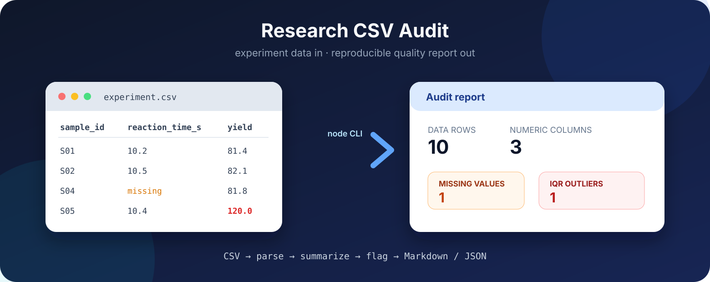

<div align="center">



# research-csv-audit

**在科研分析前检查 CSV：缺失值、描述性统计与 IQR 异常值。**

[](https://github.com/zhchb20110913/research-csv-audit/actions/workflows/ci.yml)
[](package.json)
[](package.json)
[](LICENSE)

[English](README.md) · [简体中文](README.zh-CN.md)

</div>

Research CSV Audit 读取实验 CSV，自动识别数值列并生成紧凑的数据质量报告。它会
统计缺失值和常用描述性指标，并用 1.5 倍 IQR 规则标记潜在异常值。命令行工具没有
第三方运行依赖，可输出适合人工审阅的 Markdown 或便于后续处理的 JSON。

```bash
node bin/research-csv-audit.js samples/experiment.csv
node bin/research-csv-audit.js samples/experiment.csv --output reports/audit.md
node bin/research-csv-audit.js samples/experiment.csv --format json --output reports/audit.json
```

## 特性

- **零运行依赖**：只使用 Node.js 标准库。
- **面向科研的数据摘要**：报告有效值、缺失值、均值、中位数、样本标准差、
  四分位数、极值和 IQR 异常值。
- **稳健的 CSV 解析**：支持带引号的逗号、转义引号、CRLF、UTF-8 BOM 和行尾
  缺失字段。
- **两种报告格式**：Markdown 适合审阅，JSON 可直接进入脚本、notebook 或 CI。
- **结果可复现**：相同输入和选项会得到相同的统计结果与列顺序。
- **可接入 CI**：自动化测试覆盖解析、计算、报告渲染和 CLI 文件输出。

## 安装

项目尚未发布到 npm，请克隆仓库后直接运行：

```bash
git clone https://github.com/zhchb20110913/research-csv-audit.git
cd research-csv-audit
node --test
```

需要 **Node.js 20+**，无需执行依赖安装。

## 快速开始

用内置实验数据生成两种报告：

```bash
node bin/research-csv-audit.js samples/experiment.csv --output reports/audit.md
node bin/research-csv-audit.js samples/experiment.csv --format json --output reports/audit.json
```

```text
Audit complete: 10 rows, 3 numeric columns.
Report written to .../reports/audit.md
```

示例数据包含 1 个缺失的反应时间和 1 个潜在的产率异常值，因此可以同时演示两类
检查结果。

## 审计模型

| 指标 | 定义 |
|---|---|
| 有效值 / 缺失值 | 非缺失的数值，以及可识别的缺失标记 |
| 均值 / 中位数 | 算术平均值，以及线性插值的第 50 百分位数 |
| 标准差 | 分母为 `n - 1` 的样本标准差 |
| Q1 / Q3 | 线性插值的第 25 与第 75 百分位数 |
| IQR 异常值 | 超出 `Q1 - 1.5 × IQR` 与 `Q3 + 1.5 × IQR` 的值 |

缺失标记包括空单元格、`NA`、`N/A`、`null`、`NaN` 和 `-`，匹配时不区分
大小写。潜在异常值仍需结合科研背景判断，工具不会删除或修改观测值。计算细节见
[docs/metrics.md](docs/metrics.md)。

## 示例报告

| 列 | 有效值 | 缺失值 | 均值 | 中位数 | 标准差 | 最小值 | Q1 | Q3 | 最大值 | IQR 异常值 |
|---|---:|---:|---:|---:|---:|---:|---:|---:|---:|---:|
| `temperature_c` | 10 | 0 | 29.59 | 29.6 | 7.8537 | 22 | 22.125 | 37 | 37.2 | 0 |
| `reaction_time_s` | 9 | 1 | 8.8889 | 7.9 | 1.3458 | 7.6 | 7.8 | 10.2 | 10.5 | 0 |
| `yield_percent` | 10 | 0 | 90.43 | 91.35 | 11.5377 | 80.9 | 81.875 | 91.75 | 120 | 1 |

## CLI

```text
research-csv-audit INPUT.csv [options]

--delimiter <char>  CSV 分隔符，默认：逗号
--format <type>     markdown 或 json，默认：markdown
--output <path>     将报告写入文件
--help              显示帮助
```

完整行为与退出码见 [docs/cli.md](docs/cli.md)。

## 项目结构

```text
research-csv-audit/
├── bin/                    命令行入口
├── src/                    CSV 解析与审计计算
├── test/                   Node.js 自动化测试
├── samples/                示例实验数据
├── docs/                   使用与计算说明
└── .github/workflows/      持续集成
```

## 开发

```bash
node --test
node bin/research-csv-audit.js samples/experiment.csv
```

当前测试套件包含 9 项测试，不需要网络或测试依赖。

## 文档

| 页面 | 内容 |
|---|---|
| [快速开始](docs/quickstart.md) | 第一次审计与预期输出 |
| [审计指标](docs/metrics.md) | 缺失标记、公式与假设 |
| [CLI 参考](docs/cli.md) | 参数、选项、输出与退出码 |

## 限制

- 只有当所有非缺失值都能解析为有限数值时，该列才会被识别为数值列；混合文本与
  数值的列会跳过。
- 当前版本将整个文件读入内存，适合中小型科研数据，不针对数 GB 的导出文件。
- IQR 标记用于初筛，不能替代异常值排除的科研判断。

## 许可

MIT，见 [LICENSE](LICENSE)。

